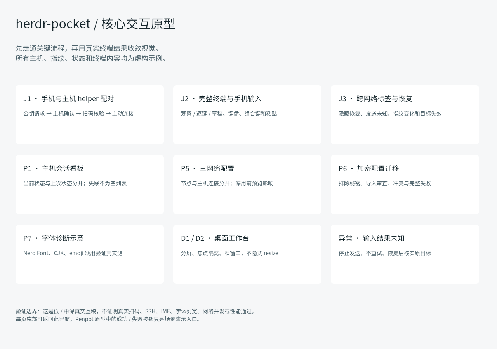
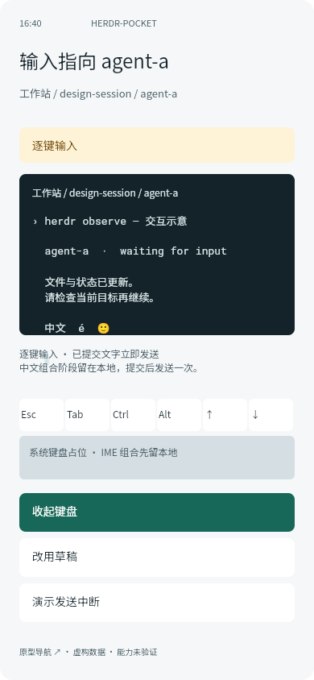
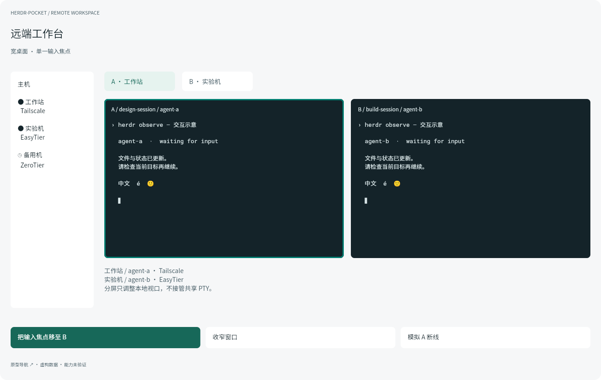
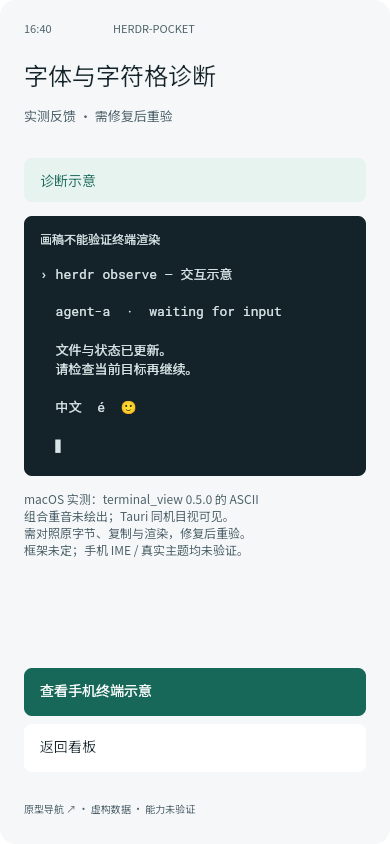
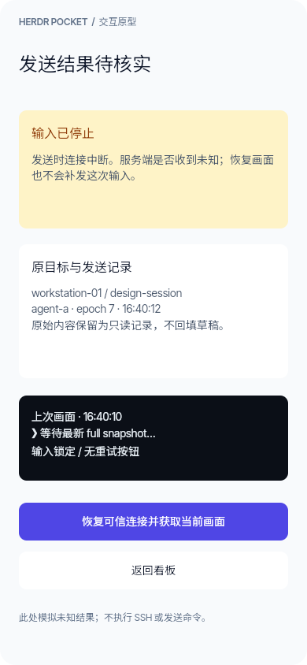
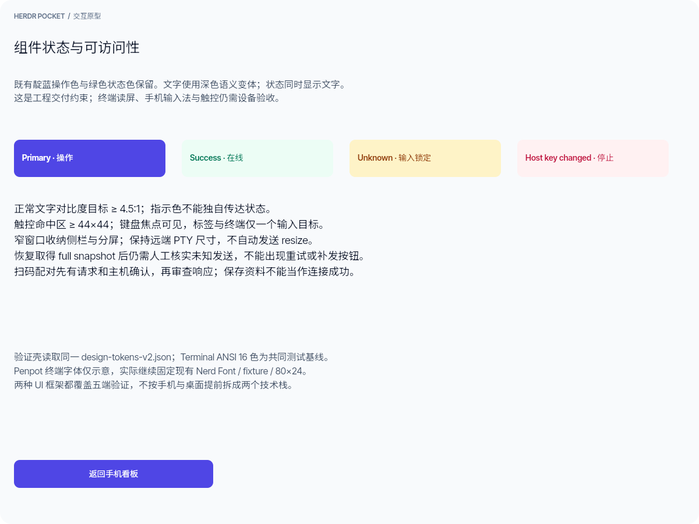
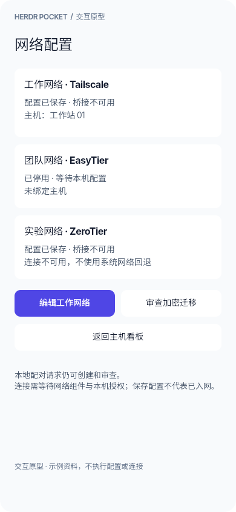
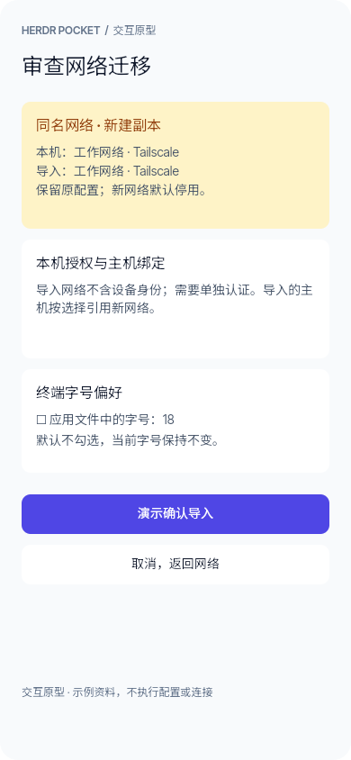
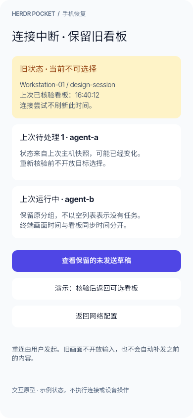
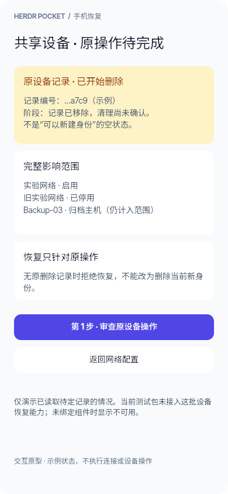

# Penpot 核心交互验证 v0.1

2026-10-30 已保存于独立 herdr-pocket 项目；低／中保真阶段，未根据真机比较定案高保真。

- [可点击原型（START 导航）](https://design.penpot.app/?screen=viewer&file-id=b55064db-d93d-80f9-8008-ddd22e6d398f&page-id=b55064db-d93d-80f9-8008-ddd22e6d3990&section=interactions&frame-id=c1974894-3caf-8067-8008-ddd4b0a14f71)
- [编辑文件](https://design.penpot.app/?screen=workspace&team-id=c514c1fb-1cda-8125-8008-a57c5bd4a25d&project-id=9a0c44dc-8874-81e7-8008-ddd20c193c16&file-id=b55064db-d93d-80f9-8008-ddd22e6d398f&page-id=b55064db-d93d-80f9-8008-ddd22e6d3990)
- [状态与出口覆盖清单](coverage.md)
- [高保真与工程化方案 (Page 2)](https://design.penpot.app/?screen=workspace&team-id=c514c1fb-1cda-8125-8008-a57c5bd4a25d&project-id=9a0c44dc-8874-81e7-8008-ddd20c193c16&file-id=b55064db-d93d-80f9-8008-ddd22e6d398f&page-id=7a22df08-251d-8016-8008-de03541c11da)
- [重载后原生对象证据](evidence/penpot-final-after-reload-20261030.json)

链接沿用当前 Penpot 账户／团队权限，未开启公开共享。文件 ID 为 `b55064db-d93d-80f9-8008-ddd22e6d398f`，页面 ID 为 `b55064db-d93d-80f9-8008-ddd22e6d3990`。内容为原生可编辑对象，包含 57 个可见画板（56 状态 + 导航）、205 条点击交互、18 个组件、25 个 tokens、650 个文本对象；另有不参与预览的组件规格板。七个流程起点含 J1/J2/J3、P5/P6、导航及补充导入失败入口。

## 实际验收

编辑器重载并重新连接 MCP 后读取上述数量；预览模式实际点击：

1. START → P1-empty → P2-request → P2-helper → P2-authorized → P2-scan → P2-review → P2-ready → P2-success → P1-loading → P1-dashboard。
2. P1-dashboard → P3-observe → P3-direct → P4-unknown；unknown 只有核实恢复、连接诊断、返回导航，没有重试／补发出口。
3. START → P4-tabs → P4-hidden → P4-b-ready，目标由 A 明确切换为 B。

其余状态通过原生对象／目的地检查，未声称逐个手动点击了 205 条边。原型不执行扫码、SSH、输入、加密、网络或授权文件修改。响应错配与过期共用拒绝状态并分别说明；helper 拒绝／撤销不声称中断已有 SSH。高保真、手机真机输入、读屏与完整键盘导航验收仍待完成。

## 编辑与重现边界

`penpot/` 保存本次原生写入脚本和状态数据；`build-core.js`、`finish-core.js`、`refine-core.js`、`supplement-core.js` 是本次建稿记录，**不是可重复覆盖当前文件的同步命令**。创建脚本限制固定文件 ID 与空页面；补充脚本拒绝重复添加。`screens.json` 已反映补齐后的 56 状态，不能将历史初建与补丁顺序再次盲跑。日常核验可调用只读 `verify.js`。后续改稿应在指定文件、指定对象范围内增量处理，保存后重载再核验。

本轮使用官方 `@penpot/mcp@2.15.4` 的 `execute_code`、`export_shape`，Penpot 应用为 2.19.0，插件明确提示版本不匹配。实际支持的 board/text/component/token/interaction 写入已核验；`createFlow` 参数不兼容，改用自动生成流程的可写 startingBoard/name。后续升级需重新验证，不将这些调用推断为跨版本保证。

来源：[官方 MCP 使用说明](https://help.penpot.app/mcp/)；Context7 先解析 Penpot 再查询 `/penpot/penpot-mcp`，旧仓库文档与实际插件 API 有差异，以本次执行记录为准。未修改用户已有服务配置，未触及其他项目设计。

## 视觉证据

## 实测反馈

macOS首轮发现 terminal_view 0.5.0 的 ASCII组合重音绘制缺陷，已增量反馈到原文件 P7-font；不扩大画板或锁定框架。工程交接需同时保存原fixture字节、buffer/复制内容与实际绘制结果，修复后按同机/字体/视口重验。Powerlevel10k、Oh My Posh真实主题与手机IME仍未验。

独立只读复核同样确认 57 可见画板、205 交互、18 组件、25 tokens、650 文本对象；J1 的10条、J2 的3条和J3 的3条关键连线存在，navigate-to 目的地无悬空；unknown 只有恢复、网络诊断和导航入口。原始结果见[独立复核](evidence/penpot-independent-review-20261030.json)。

## UI 高保真与工程化设计 (v2)

以下记录接手时的 7 画板初稿；本轮核验后的数量、补充状态和实现限制见下方“v2 增量核验与工程交接”。

为响应开发工程落地与美观度提升需求，在当前项目中开辟第二页面 `02 · UI 高保真与工程化设计 (v2)`（页面 ID `7a22df08-251d-8016-8008-de03541c11da`），严格遵循原有架构与安全规则，在低保真流程基础上建立高保真视觉候选。它不表示产品已达到生产可用或框架已定案。

**风格定位：方案 A · 极客电光靛蓝（Tech Indigo & Slate）**
针对原稿大面积使用绿色导致的“操作按钮与状态指示冲突”问题，区分操作色与状态色：
- **操作与品牌色全面迁移为 Tech Indigo 600（`#4F46E5`）**：主按钮、激活 Tab、选中外边框、键盘高亮与应用图标统一为科技感电光靛蓝；
- **绿色（`#10B981` Emerald）100% 独占归还给状态系统**：仅用于主机在线（Online）、Session 运行中、测试全部通过及 Diff 新增，使状态与操作更易区分；
- **暗色黑曜石终端（`#0B0F17`）**：搭配 JetBrains Mono 等宽字体、ANSI 语法高亮与紫蓝电光光标 `█`。

- **7 个高保真画板**：
  1. `S01`：手机看板（现代化主机卡片分组、Session 状态、微型终端预览、底部导航栏）。
  2. `S02`：终端观察模式（多会话标签条、三模切换器、黑曜石暗色终端、语法高亮与只读安全提示）。
  3. `S03`：逐键输入模式（实时发键警示、活动光标、两行人体工学辅助按键及现代软键盘占位）。
  4. `S04`：草稿编辑模式（带行号代码编辑器、多行发送安全审查、目标锁定与不自动附加回车）。
  5. `S05`：扫码配对流程（步骤条、取景框、主机 SSH 指纹与授权账户核验卡片）。
  6. `S06`：桌面宽屏工作台（1440x900 双分屏终端、左侧主机树形导航、单输入焦点高亮指示）。
  7. `S07`：设计规范与工程组件库（语义化色彩、圆角/字阶/间距 Token 及 Flutter/Tauri 跨端开发映射契约）。
- **48 个工程化 Tokens**：包含 `herdr-pocket/tokens-v2` 语义化颜色、间距、字号与圆角。
- **初稿 18 条原型交互**：连接看板、观察、逐键、草稿和配对页面；缺少的核验／失败分支在下方增量记录中补齐。
- **既有脚本记录**：`penpot/build-v2.js` 仅保存基础绘图 helpers，不能重建全部新版画板；本轮保留其原始字节。实际设计以 Penpot 文件和原生对象读回为准。

## v2 增量核验与工程交接（2026-10-30）

用户已认可新版配色。本轮保留原 S01–S07 的布局与靛蓝／绿色／暗色终端方向，新增 S08–S16 九个状态与规格板，补齐未知发送、人工恢复、指纹变化、窄窗口、独立连接验证、helper 确认／撤销指引、草稿发送预览和隐藏 B 标签恢复。

- 新版当前为 **16 个顶层可见画板、91 条原生点击交互、53 个 v2 tokens**；新增 **4 个 v2 原生库组件**。旧 V1 的 57 画板／205 交互和原 18 组件保留，文件组件总数 22。
- 原 S07 的“Flutter 负责手机、Tauri 负责桌面”、`flutter_pty` 和本地 PTY multiplexer 表述已修正：两条路线均为五端 A/B 候选，只接远端 SSH/herdr。
- 配对动作经过“主机确认 → 资料审查 → 单独验证”；取消不假装撤销主机授权。多行草稿提示明确：不追加末尾回车不等于已有换行不会执行。
- 保留亮色状态指示；补深色文字变体。`textMutedReadable` 仅用于 canvas/card，浅灰 `cardSubtle` 文字用 `textSecondary`；危险按钮白字配深红背景。目标是正常文字 4.5:1；未把原型声明成完整 WCAG、读屏或真机触控验收。
- [共享 tokens JSON](../validation/shared/design-tokens-v2.json) 保存读回的原 48 项 token 和工程映射；后增 5 项可读文字 token 在 [原生读回](evidence/v2-after-reload.json) 中。终端 ANSI 16 色属于共同测试基线，Penpot 字体仍仅是示意。

[流程覆盖与待验](v2-coverage.md) · [新版点击原型](https://design.penpot.app/?screen=viewer&file-id=b55064db-d93d-80f9-8008-ddd22e6d398f&page-id=7a22df08-251d-8016-8008-de03541c11da&section=interactions&frame-id=7a22df08-251d-8016-8008-de045ec11db9)

增量脚本是本次编辑记录，不是同步覆盖命令；`extend-v2-recovery.js` 拒绝重复新建。首次执行的参数／名称错误已按实际部分状态修复，只有最终重载读回和已导出的画板作为完成证据。`verify-v2.js` 是只读核验入口。官方 MCP 2.15.4 对 Penpot 2.19.0 的版本警告仍存在；Context7 library 查询成功，docs 两次网络 fetch failed，本次 API 依据实际官方 MCP `high_level_overview`／`penpot_api_info`，未从旧训练知识推断成功。

2026-11-06 的[手机状态增量交接](penpot/mobile-state-handoff-20261106.md)与 [S17 原型入口](https://design.penpot.app/?screen=viewer&file-id=b55064db-d93d-80f9-8008-ddd22e6d398f&page-id=7a22df08-251d-8016-8008-de03541c11da&section=interactions&frame-id=61ebadac-98b5-8013-8008-e6e7917e7a2b)记录主机受理、隐藏恢复、配置冲突和辅助键状态。后续冲突流程增加新增／保留／替换选中态与各自结果，当前读回 26 画板、149 交互、无悬空目的地；查看器实际点击 S19 → 替换 S23 → 确认 S24 → 返回 S19，其余分支未逐条手点。[读回与点击记录](evidence/v2-conflict-flow-20261106.json) · [查看器截图](evidence/v2-conflict-viewer-result-20261106.jpg)。这是演示，不执行导入；真机验收仍待完成。

## 网络配置与迁移反馈（2026-11-06）

根据 [macOS 合成配置交互记录](../docs/evidence/mobile-pair-gui/macos-network-config.json) 和 [网络契约](../validation/network-profiles/README.md)，在既有 v2 页面增量添加 S27–S30：网络列表、编辑与受影响主机、加密迁移审查、导入结果。[从网络配置开始预览](https://design.penpot.app/?screen=viewer&file-id=b55064db-d93d-80f9-8008-ddd22e6d398f&page-id=7a22df08-251d-8016-8008-de03541c11da&section=interactions&frame-id=b9d502c0-514c-80a9-8008-e7033d91f34d)。主机看板的网络入口可到达 S27。

设计明确区分配置已保存、桥接不可用和本地配对可操作；网络导入为新建停用，偏好默认不覆盖，结果未知时先核对。保留原有 Tech Indigo／Slate、其他画板和组件；新画板不代表真实设备、三网授权或连接成功。独立原生画板重载后共 30 个，新增 19 个导航对象目的地有效；Chrome 查看器实际点击 S27 → S28 → S27 和 S27 → S29 → S30 → S27。其余入口只读回，未逐个手点。[重载读回](evidence/v2-network-after-reload-20261106.json) · [执行前后对象读回](evidence/v2-network-feedback-readback-20261106.json) · [本轮覆盖](v2-coverage.md)。

Mac 测试只证明合成配置和系统文件交互，未取得可用的应用截图；手机真机视觉／触控、辅助技术、设备身份和真实三网仍待分别验证。Penpot 插件 2.15.4 对服务 2.19.0 仍提示版本不匹配；本次增量脚本只记录本次执行，不应重复运行。临时查看器、插件和本轮启动的本地服务已关闭，原编辑器保留。

## 手机草稿与共享设备恢复（2026-11-07）

基于[手机恢复实现与合成交互检查](../docs/33-mobile-recovery-design.md)，在同一 v2 页面增量保存 S31–S38，沿用既有靛蓝／Slate 配色。

- [从陈旧看板与草稿找回开始](https://design.penpot.app/?screen=viewer&file-id=b55064db-d93d-80f9-8008-ddd22e6d398f&page-id=7a22df08-251d-8016-8008-de03541c11da&section=interactions&frame-id=2a5fd934-a163-8057-8008-e8230835dfbd)
- [从共享设备待定恢复开始](https://design.penpot.app/?screen=viewer&file-id=b55064db-d93d-80f9-8008-ddd22e6d398f&page-id=7a22df08-251d-8016-8008-de03541c11da&section=interactions&frame-id=2a5fd934-a163-8057-8008-e823088d7aeb)
- [重载原始读回](evidence/v2-mobile-recovery-reloaded-20261107.json) · [原对象对照与实际点击范围](evidence/v2-mobile-recovery-comparison-20261107.json) · [完整覆盖](v2-coverage.md)

重载后 38 个画板、1,155 个形状、212 个交互对象；无悬空目的地或画板外孤立形状，新增文本没有超出画板。原 1,008 对象的名称、类型、父级、几何、文字、填充和导航边逐项一致；这不是对每一种 Penpot 属性的全量比较。原 22 个组件和 25／53 项 token sets 保留，没有据此宣布完整组件库或真机无障碍通过。

查看器实际点击 S31 → S32 → S38 → S33，以及 S34 → S35 → S36 → S34、S36 → S37。其他连接为读回检查。原型以虚构记录演示原目标找回、未知结果只读核对和二步审查，不执行系统剪贴板、设备身份、SSH 授权或网络操作。

首次[增量脚本](penpot/mobile-recovery-20261107.js)因示例文本首行为空生成空名称而部分失败；[定点补全脚本](penpot/mobile-recovery-finish-20261107.js)复用已创建对象完成，随后[只读核验](penpot/verify-mobile-recovery-20261107.js)及重载通过。两份写入脚本记录一次实际执行，不是可反复运行的同步器。官方 MCP 2.15.4／应用 2.19.0 的版本不匹配警告仍保留。

临时浏览器夹具、查看器、插件与本轮 Vite／Penpot MCP 服务均已关闭，视口覆盖已恢复，原编辑页保留。已有 Android APK 未变化；手机触控、IME、KeyStore、真实组网与最终框架选型仍待独立证据。
