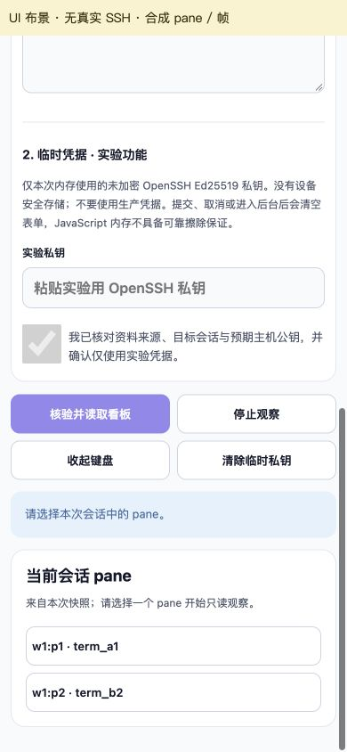

# 手机看板、持续观察与配对并行验证

2026-10-30。手机优先的下一小步已从[一帧只读快照](12-mobile-remote-readonly.md)推进到“审查连接 → 当前命名会话看板 → 明确选择 pane → 持续观察 → 停止与陈旧画面”。Flutter 与 Tauri 使用同一目标完成 **18/18 项真实 SSH/herdr 对照**；配对 v2 和设备密钥桥完成独立云端验证。完整 M1、手机运行与框架选型仍未验收。

## 可操作范围

两个 GUI 都先核验预期 host key，再认证并查询本次 session 的真实 snapshot。看板只列该快照的 `pane_id`／`terminal_id`，等待用户选择；没有自动选择第一个 pane、跨 session 发现或根据终端文本推测 agent 状态。实际 pane 选择绑定同一连接、命名会话、配置根与稳定 terminal ID。

选择后接收一张 full 和后续 full/delta，显示本地更新时间与“只读观察中”。停止、离开页面、后台、断线或序号错误使本次 generation 失效；保留画面时标“陈旧”，新尝试必须主动发起并重新审查。当前远端入口没有输入、粘贴发送、SSH PTY、takeover 或 resize；离线实验室的输入捕获继续独立。布局和键盘变化只改变本地视口。

本步固定 herdr **0.9.5 / protocol 22**，DartSSH2 **4.1.0**、russh **0.65.0**；锁与字体 fixture 保留。协议 frame 不回传可认证的目标身份，绑定仍依据规范 socket 路径、snapshot 与固定且严格引用的 observe 命令。目标错配不会回退 default 会话。

两端共用[行为与上限契约](../validation/shared/remote-contract.json)：首个合法 full 的绝对预算10秒，碎片与stderr不重置；此后静默本身不失败。seq必须连续且不超过JS安全整数；单行1MiB、解码帧64KiB、stderr累计64KiB，最多256个唯一pane。每次仅一个frame等待消费确认，Tauri在xterm写回调后ACK，Flutter等待消费者；远端终端不累计scrollback。坏帧、重复、缺帧、EOF立即结束，不跳过损坏增量。

这是有界接收实现，不是全进程内存测量。DartSSH2另有固定2MiB SSH接收窗口／32KiB包；Rust窗口64KiB／32KiB包、channel队列2。报告的 `bufferHighWaterBytes` 只统计解码单帧，不包含SSH、JSON行、渲染器或进程内存；不能据此作框架性能排名。

## 已执行的对照

实现提交为 `73ce2f8794a65c82975cf014d257ca339a283bdc`；`c276c95fc3796b6f6de1ce3b6978195b5573a541` 加入配对与Flutter生命周期测试修正；`d459919be130d2fcefdc4bf6e49aa020b811ec4f` 仅修正Tauri看板卡片CSS。后两次没有修改SSH适配器／harness，因此协议证据按原源码归档，不伪称在新SHA重跑。

真实链路为 [run 41060251076](https://github.com/Luck9Star/herdr-pocket/actions/runs/41060251076)，[脱敏报告与复验入口](evidence/mobile-observe/41060251076/README.md)。OpenSSH 9.6p1与herdr运行在Ubuntu24.04 runner的临时loopback目标，两路线共用字体、80×24合成终端及每200ms变化的行。临时keys、授权fixture与配置不上传，接收器计数为 **0 bytes**，owned进程与keys清理成功。

| 同一真实目标的用例 | Rust | Dart | 证明范围 |
| --- | --- | --- | --- |
| 原六项：full、错误pin、会话绑定错误、两个session同名pane、snapshot后取消、显式再连 | 6/6 | 6/6 | 错误pin实际在认证前拒绝；无远端输入 |
| 持续观察后主动停止 | 3帧／2delta | 3帧／2delta | full与真实增量已收到，取消完成 |
| 首full后立即停止 | 1帧／0delta | 1帧／0delta | 已连接后的主动取消 |
| 同一CLI显式再次观察 | 2连接／4帧／2delta | 2连接／4帧／2delta | 每次重新full，不自动重放 |

这18项执行GUI共享的适配器代码，CLI主动选择pane。它不是GUI有效凭据点击成功、手机后台恢复、长期网络抖动或三网络并发证明。真实用例没有注入任意损坏frame；乱序／迟到／超限拒绝由独立单测覆盖。两端本次解码单帧高水位均2572 bytes，CLI耗时包含启动／JIT，不比较性能。

独立代码检查推动了首full绝对超时、取消generation归属、JS安全序号、Dart取消监听器移除和CLI统计口径修正。实际首轮Flutter [候选41060251060](https://github.com/Luck9Star/herdr-pocket/actions/runs/41060251060)与[baseline41060251057](https://github.com/Luck9Star/herdr-pocket/actions/runs/41060251057)在Widget测试失败：测试使用了不合法的hidden→resumed跳转，引发后续连锁失败。`c276c95`按完整inactive/hidden/paused路径修正并在tearDown复原；这次修正没有改变产品生命周期实现。

## 手机布局与设计反馈

沿用用户认可的 [Penpot v2 文件](https://design.penpot.app/?screen=workspace&team-id=c514c1fb-1cda-8125-8008-a57c5bd4a25d&project-id=9a0c44dc-8874-81e7-8008-ddd20c193c16&file-id=b55064db-d93d-80f9-8008-ddd22e6d398f&page-id=7a22df08-251d-8016-8008-de03541c11da)和[已保存的覆盖清单](../design/v2-coverage.md)：靛蓝操作、Slate文字、暗色终端。既有S01/S02用于看板与观察，S09的人工恢复约束继续保留；当前停止后的重新核验仍按只读实验边界实现；本轮没有新增或重存Penpot对象。

Tauri使用生产页面和逻辑的临时副本、显式标注的合成IPC布景验证390×844、360×740、320×380：页面无横向溢出，pane和操作按钮至少44px，不自动选择pane；选第二个pane后显示对应合成frame，持续更新；停止清空字段／确认，画面陈旧，缩放后计数保持不变。终端80列在内部横向滚动，短视口只是键盘占用近似。具体[检查记录](evidence/mobile-observe/browser/verification.json)和[布景源码／来源](evidence/mobile-observe/browser/source.json)可复核。

实看发现看板复用终端深色背景而标题继承深色文字，已在 `d459919` 改用card/textPrimary/textSecondary语义token及独立内边距；pane按钮纵向排列并允许长ID换行。截图只证明浏览器布局与事件状态，不是SSH、字体列宽、手机触控、IME或读屏验收。

Tauri `d459919` 和 Flutter 修补候选 `c276c95` 的Mac包均已下载验SHA并实际启动：只读入口、合成无效资料拒绝、临时字段与审查确认清空通过；Tauri另核验编辑目标会取消审查。Flutter表单可滚动，但AX导出字段缺少标签且部分文本值滞后，读屏尚未验收。没有在GUI中输入有效SSH凭据。见[Mac原生记录](evidence/mobile-observe/macos/verification.json)。两应用已Cmd-Q退出并确认对应进程消失；临时浏览器页、视口覆盖和预览服务也已关闭／复原。

## 配对与设备密钥

新增[配对实验](../validation/pairing/README.md)和v2 JSON契约，生成设备独立Ed25519公钥请求，绑定request ID、账号、手机指纹、预期host指纹及期限。响应需用户独立审查来源；`authorized-unverified`不等于连接成功，只有同一目标实际pin+认证结果才允许进入paired。取消／到期不谎称撤销主机授权；手机未收到授权响应时仍可审查匹配的主机撤销响应，之后拒绝重放授权。

解析固定UTF-8、2048bytes、字段白名单、无重复字段／控制字符、TTL≤600秒；独立审阅补齐拒绝UTF-16/32与“未知授权后确认撤销”的回归。Python参考固定cryptography46.0.3，公钥解析使用成熟实现。21项配对与15项既有helper测试均只用新建fixture，未读取／修改真实授权文件。

[run 41061177628](https://github.com/Luck9Star/herdr-pocket/actions/runs/41061177628)在`c276c95`完成三job，下载校验与原始安全产物见[云端证据](evidence/mobile-observe/41061177628/README.md)：

| 层 | 实际通过 | 未验证／未实现 |
| --- | --- | --- |
| Ubuntu与Mac契约 | 各21项配对、15项helper；默认只预览、明确确认后才写自建fixture | 手机GUI、相机、生产helper账户／权限／跨进程一次性处理 |
| Apple桥 | Mac编译、CryptoKit Ed25519内存backend签名／验证、锁定与删除拒绝；iOS simulator typecheck | 系统Keychain调用0；设备锁屏、备份、entitlement、SSH signer接线未验证 |
| Android桥 | API35 Java AES-GCM封装桥编译 | Keystore运行、Ed25519库生成／签名、noBackupFilesDir原子保存、GUI接线未实现／验证 |

设备接口限定create/public/sign/delete，没有跨设备私钥导出。Apple设计为ThisDeviceOnly、非同步Keychain保护Ed25519 seed静态存储；不能称为Secure Enclave Ed25519。Android验证桥仅API35，考虑官方API31–34 unlocked-device限制；这不是产品最低版本决定。两端签名时的seed内存、运行权限与真实设备行为仍需实测，不能从编译或内存double外推。

## 测试包与复验

[Flutter修补候选41061177588](https://github.com/Luck9Star/herdr-pocket/actions/runs/41061177588) 的测试、Mac绘制检查与五端构建均成功；[Tauri新版41062065682](https://github.com/Luck9Star/herdr-pocket/actions/runs/41062065682) 五端构建也已全部成功。逐job、源码及历史失败见[交付矩阵](evidence/mobile-observe/builds/README.md)与[机器可读记录](evidence/mobile-observe/builds/delivery-checks.json)。原版terminal_view [baseline41061177552](https://github.com/Luck9Star/herdr-pocket/actions/runs/41061177552) 的五端编译成功，但独立组合重音绘制检查仍失败；修补候选不是官方新版本，也不意味着选型完成。

| 平台 | Flutter修补候选 `c276c95` | Tauri `d459919` | 运行边界 |
| --- | --- | --- | --- |
| Android | [测试APK](https://github.com/Luck9Star/herdr-pocket/actions/runs/41061177588/artifacts/12979242829) | [arm64测试APK](https://github.com/Luck9Star/herdr-pocket/actions/runs/41062065682/artifacts/12980657085) | 两包构建成功、下载验SHA；未安装真机 |
| iOS | [未签名App](https://github.com/Luck9Star/herdr-pocket/actions/runs/41061177588/artifacts/12978943348) | [模拟器App](https://github.com/Luck9Star/herdr-pocket/actions/runs/41062065682/artifacts/12978843825) | 构建成功；均不等于可分发真机IPA，运行未验证 |
| macOS | [测试App](https://github.com/Luck9Star/herdr-pocket/actions/runs/41061177588/artifacts/12980005671) | [测试App](https://github.com/Luck9Star/herdr-pocket/actions/runs/41062065682/artifacts/12980576230) | 两包构建成功、下载验SHA及上述有限原生检查；真实GUI SSH未验证 |
| Windows | [测试bundle](https://github.com/Luck9Star/herdr-pocket/actions/runs/41061177588/artifacts/12979013262) | [测试安装器](https://github.com/Luck9Star/herdr-pocket/actions/runs/41062065682/artifacts/12981802286) | 两包构建成功；均未安装／运行 |
| Linux | [测试bundle](https://github.com/Luck9Star/herdr-pocket/actions/runs/41061177588/artifacts/12979940766) | [deb测试包](https://github.com/Luck9Star/herdr-pocket/actions/runs/41062065682/artifacts/12981335575) | 构建成功；未安装／运行 |

当前四个Android/Mac应用产物已独立核对下载文件、manifest来源SHA与校验和。仅日志／renderer artifact不算应用；Tauri旧 `73ce2f8` run在新版推送时按并发规则取消，已完成job与Windows取消分别保留。网络中断造成的下载EOF经重试恢复，不记为构建失败。

1. 下载对应平台artifact，先校验manifest源码和SHA256SUMS；保留期14天。Mac先检查入口、审查后编辑失效、无效合成资料拒绝／清空；用完退出应用。不要把真实凭据交给实验入口。
2. 真实SSH复跑使用[云端隔离harness](../validation/remote-harness/README.md)，检查18项、输入0和cleanup。持续观察三项必须取得实际frame／delta／连接数以及取消完成，不能只看CLI退出0。
3. 配对复跑按[README](../validation/pairing/README.md)，默认preview和明确确认demo均只创建临时fixture；native桥编译与系统存储运行分列。
4. 手机条件具备后优先安装Android候选，使用同一字体／fixture／视口完成IME、触控、键盘、后台和密钥存储验收。iOS simulator／unsigned app不是可安装真机IPA。本轮只有云端与Mac，不重复索取不存在的设备条件。

## 下一阶段顺序

1. 手机配对公开请求／响应审查、等待授权、失败与撤销状态接进两个候选GUI；复用当前v2配色与共享信息模型。先以可复验测试身份和隔离目标验证，真实主机授权仍需要专门范围。
2. Android补固定成熟Ed25519 signer与原子密文存储；Apple桥接四方法到GUI。继续云编译、内存double和Mac隔离探针，系统存储／手机证据单独补齐，禁止明文兜底或自动再建身份。
3. 补GUI→真实隔离SSH目标→持续观察的端到端路径、慢消费者与迟到数据；在稳定绑定上接手机逐键／辅助键／草稿，再做跨网络多标签与恢复。结果未知不重放，布局不改共享PTY。
4. 手机正确性通过后再比较性能／维护成本，决定框架和核心组合并回写Penpot实现规格。保留[15格单网络／20格并发矩阵](09-prototype-validation.md)，本轮没有新增三网或Windows桥运行结果。
